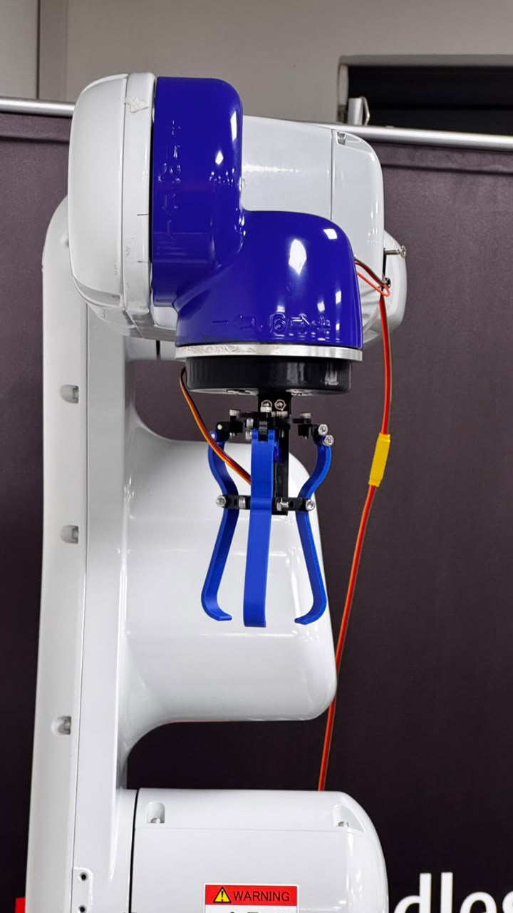
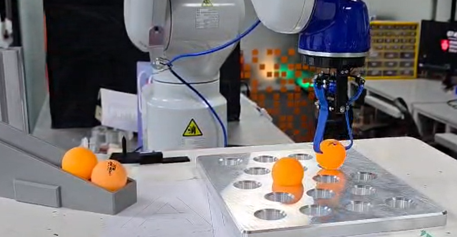
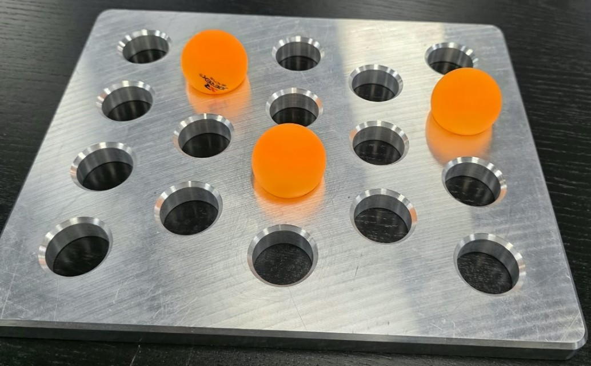

# 🤖 EPSON VT6-A901S | Automated Pick-and-Place Operation

**Industrial Robotics · Robot Manipulation · SPEL+ Programming · EPSON RC+ 8.0**

An automated pick-and-place project developed as part of the **Robotic Manipulation (PDE4431)** coursework at Middlesex University Dubai.

The project involves programming an EPSON VT6-A901S six-axis industrial robot to pick ping-pong balls from a designated stand and accurately place them at three assigned positions on a steel plate.

---

## 🎬 Project Demonstration

**Watch the robot perform the complete pick-and-place sequence:**
<a href="https://livemdxac-my.sharepoint.com/personal/aa6724_live_mdx_ac_uk/_layouts/15/stream.aspx?id=%2Fpersonal%2Faa6724%5Flive%5Fmdx%5Fac%5Fuk%2FDocuments%2FAkamksha%20Ranil%20%2D%20Robot%20Manipulation%20%2D%20PDE4431%20demonstration%2Emp4&nav=eyJyZWZlcnJhbEluZm8iOnsicmVmZXJyYWxBcHAiOiJPbmVEcml2ZUZvckJ1c2luZXNzIiwicmVmZXJyYWxBcHBQbGF0Zm9ybSI6IldlYiIsInJlZmVycmFsTW9kZSI6InZpZXciLCJyZWZlcnJhbFZpZXciOiJNeUZpbGVzTGlua0NvcHkifX0&ga=1&referrer=StreamWebApp%2EWeb&referrerScenario=AddressBarCopied%2Eview%2E07d9fb06%2D4b07%2D49ca%2Da092%2Ddadfc45d9551">
  
</a>

*Click the image to watch the complete demonstration.*

---

## 📌 Project Overview

The objective of this project was to develop and implement an automated pick-and-place operation using the EPSON RC+ 8.0 programming environment and SPEL+ programming language.

The robot executes a programmed sequence involving object pickup, transfer, and placement at multiple predefined locations.

The operation consists of:

- Initialising the robot and moving to the designated home position.
- Approaching the pickup location using a predefined approach height.
- Activating the gripper to securely pick up the workpiece.
- Retracting from the pickup location.
- Transferring the object to one of three designated placement positions.
- Releasing the object and retracting safely.
- Repeating the sequence until all three placements are completed.
- Returning the robot to its home position.

## 🦾 Hardware and Software

| Component | Specification |
|---|---|
| Robot | EPSON VT6-A901S |
| Robot configuration | Six-axis industrial robot |
| Maximum reach | 1000 mm |
| Maximum payload | 6 kg |
| Programming environment | EPSON RC+ 8.0 |
| Programming language | SPEL+ |
| End-of-arm tooling | Gripper |
| Communication interface | USB |
| Workpiece | Ping-pong balls |
| Placement surface | Steel plate |

### Robot Setup

*EPSON industrial robot and end-of-arm tooling used for the practical task.*

### Assigned Placement Pattern

*Designated pickup and placement arrangement for the pick-and-place operation.*

## ⚙️ Technical Implementation

### Robot Positioning and Motion Control

Robot positions were taught using the EPSON RC+ programming environment. Separate positions were defined for the home position, pickup location and three placement locations.

The `GO` and `MOVE` commands were used to control robot movement. Approach and retract positions were generated using a 50 mm tool Z-axis offset through the `TLZ(50)` function, with the offset direction selected according to the required approach geometry.

### Tool Offset Implementation

The `TLZ(50)` instruction was used to generate approach and retract positions relative to the tool coordinate system.

In the implemented program, `-TLZ(50)` was applied to the taught pickup and placement points to create offset positions. This allowed the robot to approach and withdraw from the working locations while maintaining additional clearance.

### Gripper Control

The gripper was controlled through digital output 11 of the robot controller.

| Instruction | Function |
|---|---|
| `Off 11` | Opens the gripper |
| `On 11` | Closes the gripper |

Separate `Grip_open` and `Grip_close` functions were implemented to simplify gripper control. Waiting instructions were included to allow sufficient time for the gripper to complete each operation.

## 💻 Program Structure

The SPEL+ program was organised into individual functions to improve readability, modularity and ease of modification.

| Function | Description |
|---|---|
| `main` | Controls the overall execution sequence |
| `Pick` | Performs the object pickup operation |
| `Drop1` | Executes the first placement |
| `Drop2` | Executes the second placement |
| `Drop3` | Executes the third placement |
| `Grip_open` | Opens the gripper |
| `Grip_close` | Closes the gripper |

### Execution Sequence

The main function calls the pickup and placement functions in the following order:

`Pick → Drop1 → Pick → Drop2 → Pick → Drop3`

After completing all three placement operations, the robot returns to the designated home position.

## 📂 Repository Contents

| File / Folder | Description |
|---|---|
| `Main.prg` | Complete SPEL+ source code |
| `README.md` | Project documentation |
| `assets/` | Project photographs and demonstration thumbnail |

## 🧠 Key Learning Outcomes

This project provided practical experience in:

- Programming six-axis industrial robots using SPEL+.
- Establishing controller-to-PC communication.
- Teaching and defining robot positions using EPSON RC+.
- Understanding robot motion commands and movement sequencing.
- Implementing tool coordinate offsets for approach and retract movements.
- Controlling an end-effector through digital outputs.
- Developing modular robot programs using functions.
- Testing and refining automated pick-and-place operations.
- Understanding the importance of safe robot trajectories and accurate object placement.

## 🚀 Potential Improvements

Possible extensions to the project include:

- Implementing local coordinate frames to simplify placement position definition.
- Using increment-based taught-point selection to reduce repetitive programming.
- Exploring continuous-path movement to improve motion transitions.
- Integrating sensors or computer vision for automatic object detection.
- Optimising movement speeds and cycle time.

## 📚 References

1. [EPSON VT6L All-in-One 6-Axis Robot – Seiko Epson Corporation](https://epson.com/For-Work/Robots/6-Axis/Epson-VT6L-All-in-One-6-Axis-Robot/p/RVT6L-A901SS).
2. Seiko Epson Corporation, *EPSON RC+ 8.0 SPEL+ Language Reference*.

---

**Course:** PDE4431 – Robotic Manipulation  
**Institution:** Middlesex University Dubai
